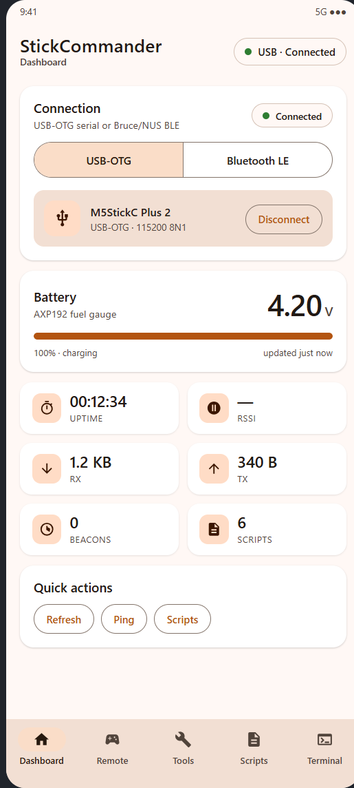
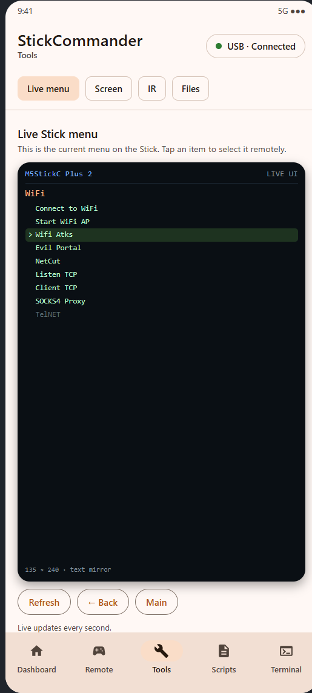
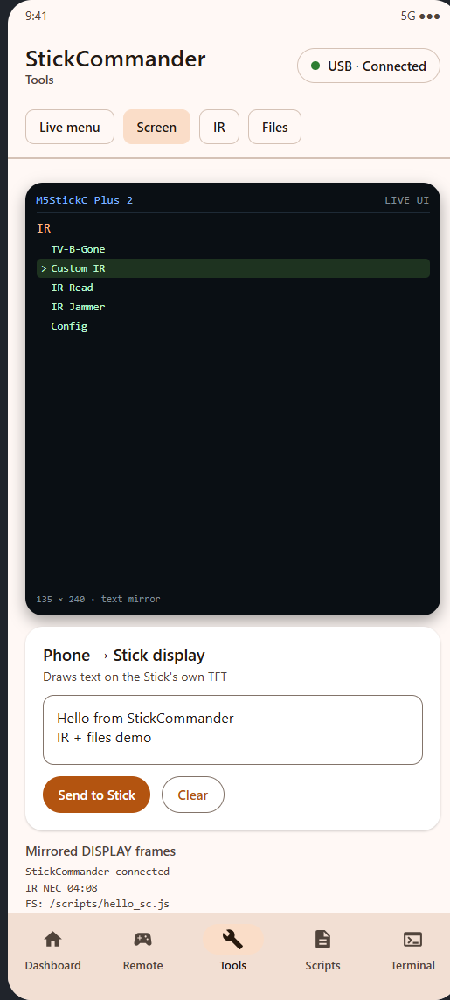
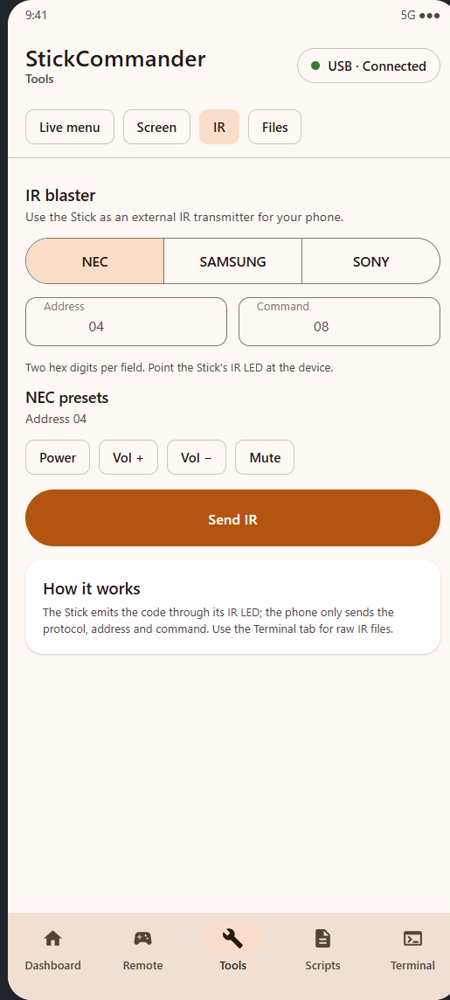
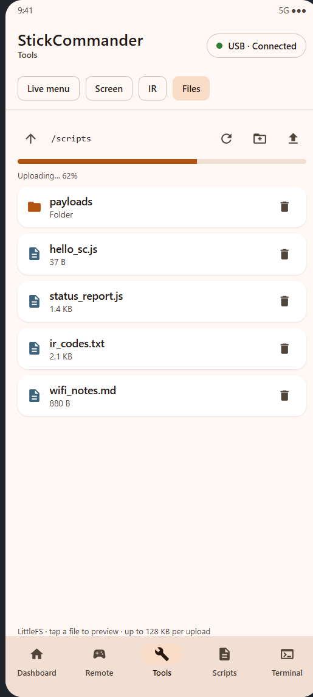
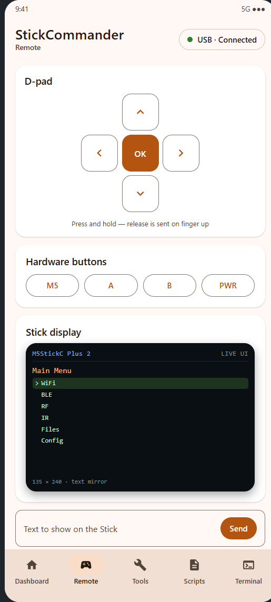

# StickCommander

**Turn an M5StickC Plus 2 running Bruce into a remote-controlled sidekick for your phone.**

StickCommander is a Material 3 Android app plus a Bruce 1.16.1 firmware patch. It talks to
the Stick over USB-OTG serial or Bluetooth LE, mirrors the real on-device menu, draws text on
the Stick's screen, fires IR codes, browses LittleFS, and gives you a full terminal.

[Website (English)](https://121kirillmorti.github.io/stickcommander/) ·
[Сайт (русский)](https://121kirillmorti.github.io/stickcommander/ru/) ·
[Latest release](https://github.com/121kirillmorti/stickcommander/releases/latest)



## Features

| Screen | What it does |
| --- | --- |
| **Dashboard** | Live battery voltage/percentage from the AXP192, connection state, uptime, RX/TX counters, beacon count, quick actions (refresh, ping, script list). |
| **Remote** | Virtual D-pad plus M5/A/B/PWR press-and-hold buttons, mirrored Stick UI, and a text box that writes to the Stick display. |
| **Tools → Live menu** | Mirrors the *actual* Bruce menu (title, items, disabled entries, current selection) and updates every second. Tap an item to open it remotely. Back/Main buttons navigate the Stick. |
| **Tools → Screen** | Text mirror of the Stick's UI plus **Phone → Stick display**: send any text to be drawn on the 135×240 TFT. |
| **Tools → IR** | Use the Stick as an external IR blaster for the phone: NEC, Samsung and Sony (12/15/20 bit), with hex address/command fields and NEC presets. |
| **Tools → Files** | LittleFS file manager: browse folders, preview text files, upload your own file in 256-byte chunks with a progress bar, create folders, rename and delete. |
| **Scripts** | Phone-side script library, device-side listing, upload-and-run, create/delete. |
| **Terminal** | Filtered log stream (INFO/WARN/ERROR/Beacon/RAW), auto-scroll, copy transcript, raw command input. |

| Tools: live menu | Tools: screen | Tools: IR | Tools: files |
| --- | --- | --- | --- |
|  |  |  |  |

| Dashboard | Remote |
| --- | --- |
|  |  |

> The images above are UI previews rendered from the app's own Compose layout, so they match
> the shipped screens and text exactly.

## How it works

```
┌──────────────────────────┐        USB-OTG (115200 8N1)        ┌────────────────────────────┐
│  StickCommander (Android)│ ─────────────────────────────────► │  M5StickC Plus 2            │
│  Compose UI + Repository │ ◄───────────────────────────────── │  Bruce 1.16.1 + bridge      │
│                          │        BLE NUS / Bruce BLE         │  stickcommander.cpp         │
└──────────────────────────┘                                    └────────────────────────────┘
        │                                                                   │
        ├─ Dashboard / Terminal ◄──── STATUS / LOG / DISPLAY ──────────────┤
        ├─ Tools: Live menu    ◄──── MENU:TITLE/SEL/ITEM/END ──────────────┤
        ├─ Tools: Files        ◄──── FS:LIST/ENTRY/FILE/DATA ──────────────┤
        └─ Tools: IR / Screen  ────► CMD:IR / CMD:SCREEN ───────────────────┘
```

The firmware patch adds a small command bridge inside Bruce:

- a line-oriented ASCII protocol (`CMD:...`) read from USB serial and the BLE serial service;
- a **live menu bridge** that reads Bruce's global `options` / `menuOptionLabel` vector and sets
  `forceMenuOption`, `EscPress`, `returnToMenu`, so the app navigates the real firmware menu
  instead of faking one;
- **screen drawing** directly on the TFT (text layout, theme colors);
- **IR** through Bruce's existing `sendNECCommand` / `sendSamsungCommand` / `sendSonyCommand`;
- **LittleFS** operations with base64 framing and chunked upload.

The protocol is newline-delimited. Example session:

```text
> CMD:MENU:LIST
< MENU:TITLE:V2lGaQ==
< MENU:SEL:-1
< MENU:ITEM:0:1:Q29ubmVjdCB0byBXaWZp
< MENU:END
> CMD:MENU:OPEN:0
< OK:menu:0

> CMD:SCREEN:TEXT:SGVsbG8gZnJvbSBTdGlja0NvbW1hbmRlcg==
< OK:screen:text

> CMD:IR:NEC:04:08
< OK:ir:NEC

> CMD:FS:LIST:Lw==
< FS:LIST:Lw==
< FS:ENTRY:D:0:c2NyaXB0cw==
< FS:LISTEND
```

Full protocol reference: [`firmware/README.md`](firmware/README.md).

## Quick start

### 1. Flash the firmware

The ready-made merged image is attached to the [latest release](https://github.com/121kirillmorti/stickcommander/releases/latest)
(`Bruce-m5stack-cplus2.bin`, flash at `0x0`).

```bash
esptool.exe --port COM3 --baud 460800 write-flash 0x0 Bruce-m5stack-cplus2.bin
```

The Stick shows up as a CH9102 USB-UART bridge (VID `1A86`, PID `55D4`). Keep the original
8 MB dump before flashing if you want a way back.

### 2. Install the app

```bash
adb install -r StickCommander-debug.apk
```

### 3. Connect

- **USB:** plug the Stick into the phone with an OTG cable, open the app, choose **USB-OTG →
  Connect** and grant the USB permission.
- **BLE:** on the Stick open **Config → Advanced → Toggle BLE API**, then in the app choose
  **Bluetooth LE → Scan** and pick the Stick.

### 4. Use it

Open **Tools**, pick a section, and the app polls the Stick automatically. Tap a menu item to
open it, type text to draw it on the display, send an IR code, or upload a file.

## Building

### Firmware

```bash
git clone https://github.com/BruceDevices/firmware.git bruce
cd bruce && git checkout 1.16.1
# copy the files from firmware/integration/ over the tree, then:
pio run -e m5stack-cplus2
```

`firmware/integration/` contains the bridge, the modified `serialcmds.cpp`, `main.cpp`,
`platformio.ini`, the FastLED/LTO patch script and the BLE service changes.

### App

Requirements: JDK 17, Android SDK 35.

```bash
./gradlew assembleDebug      # Windows: gradlew.bat assembleDebug
./gradlew testDebugUnitTest
```

## Safety and legal

StickCommander is a remote control for hardware **you own**. IR transmission, Wi-Fi/BLE
features of Bruce and the terminal are powerful tools; use them only where you have
permission. The firmware is built on [Bruce](https://github.com/BruceDevices/firmware)
(AGPL-3.0), so this repository is distributed under **AGPL-3.0** as well. The app is a
separate program that speaks the documented protocol.

## Credits

- [Bruce](https://github.com/BruceDevices/firmware) — the firmware this project extends.
- [usb-serial-for-android](https://github.com/mik3y/usb-serial-for-android) — USB CDC/CH9102.
- M5Stack for the M5StickC Plus 2 hardware and libraries.

---

**Русская документация:** [README.ru.md](README.ru.md) · [страница проекта](https://121kirillmorti.github.io/stickcommander/ru/)
