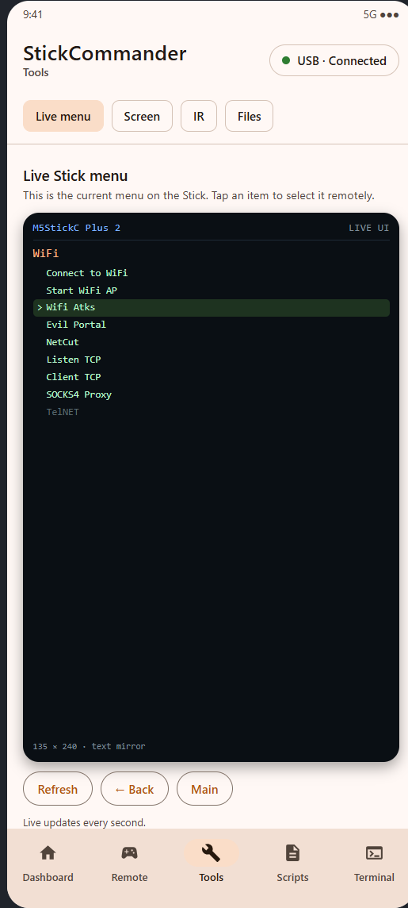
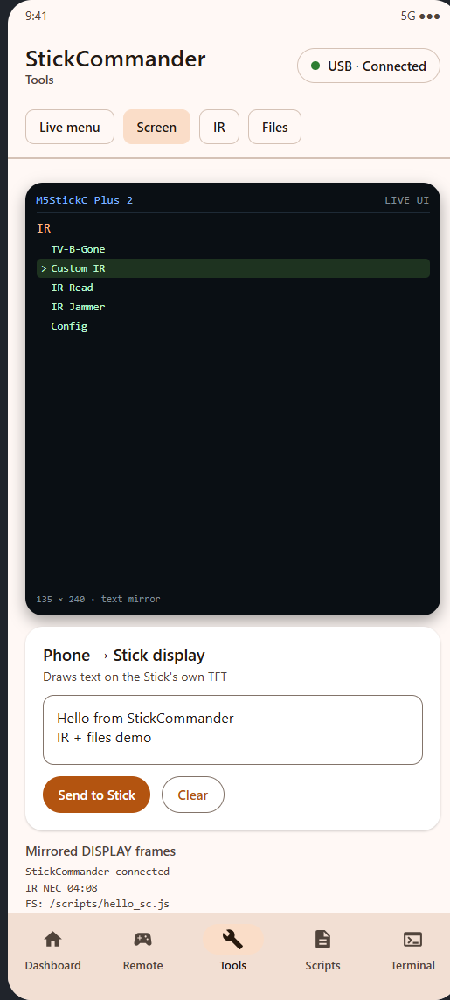
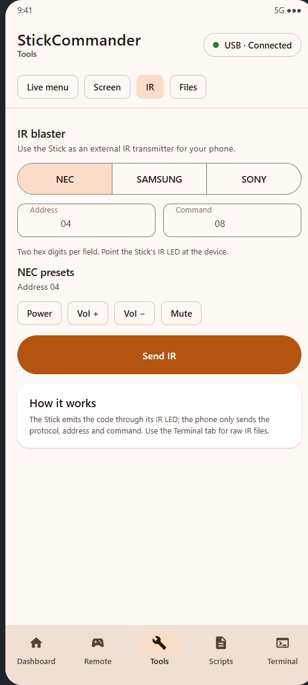
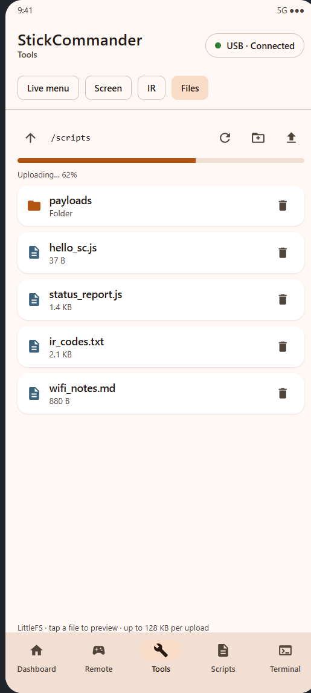
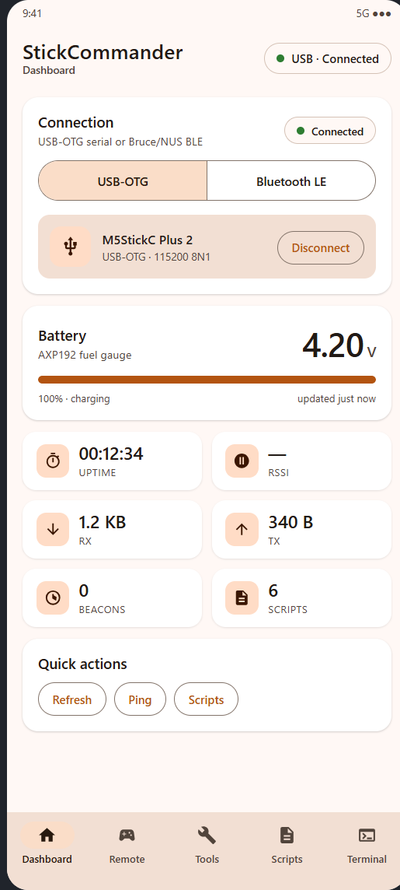
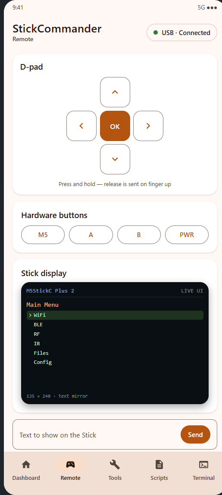

# StickCommander

**Превращает M5StickC Plus 2 с прошивкой Bruce в управляемую с телефона штуку.**

StickCommander — это Android-приложение в Material 3 плюс патч прошивки Bruce 1.16.1.
Связь по USB-OTG (serial) или Bluetooth LE: приложение зеркалит настоящее меню Stick,
рисует текст на его экране, отправляет ИК-коды, работает с файловой системой LittleFS
и даёт полноценный терминал.

[Сайт на русском](https://121kirillmorti.github.io/stickcommander/ru/) ·
[English site](https://121kirillmorti.github.io/stickcommander/) ·
[Последний релиз](https://github.com/121kirillmorti/stickcommander/releases/latest)

## Возможности

| Экран | Что умеет |
| --- | --- |
| **Dashboard** | Напряжение и процент батареи с AXP192, состояние подключения, uptime, счётчики RX/TX, число beacon'ов, быстрые действия (обновить статус, ping, список скриптов). |
| **Remote** | Виртуальный D-pad и кнопки M5/A/B/PWR с удержанием, зеркало экрана Stick и поле текста, который рисуется на дисплее Stick. |
| **Tools → Live menu** | Зеркало **реального** меню Bruce (заголовок, пункты, недоступные пункты, текущее выделение), обновление раз в секунду. Тап по пункту открывает его на Stick. Кнопки Back/Main листают прошивку. |
| **Tools → Screen** | Текстовое зеркало интерфейса Stick и блок **Phone → Stick display**: любой текст рисуется на TFT 135×240. |
| **Tools → IR** | Stick как внешний ИК-передатчик для телефона: NEC, Samsung, Sony (12/15/20 бит), hex-поля адреса и команды, пресеты NEC. |
| **Tools → Files** | Менеджер LittleFS: папки, предпросмотр текстовых файлов, загрузка своего файла чанками по 256 байт с прогресс-баром, создание папок, переименование и удаление. |
| **Scripts** | Библиотека скриптов на телефоне, список на устройстве, загрузка и запуск, создание и удаление. |
| **Terminal** | Поток логов с фильтрами (INFO/WARN/ERROR/Beacon/RAW), автопрокрутка, копирование, ввод произвольных команд. |

| Tools: меню | Tools: экран | Tools: ИК | Tools: файлы |
| --- | --- | --- | --- |
|  |  |  |  |

| Dashboard | Remote |
| --- | --- |
|  |  |

> Скриншоты — превью интерфейса, отрисованные по реальной Compose-разметке приложения,
> поэтому экраны и тексты совпадают с тем, что устанавливается.

## Как это работает

```
┌──────────────────────────┐        USB-OTG (115200 8N1)        ┌────────────────────────────┐
│  StickCommander (Android)│ ─────────────────────────────────► │  M5StickC Plus 2            │
│  Compose UI + Repository │ ◄───────────────────────────────── │  Bruce 1.16.1 + bridge      │
│                          │        BLE NUS / Bruce BLE         │  stickcommander.cpp         │
└──────────────────────────┘                                    └────────────────────────────┘
        │                                                                   │
        ├─ Dashboard / Terminal ◄──── STATUS / LOG / DISPLAY ──────────────┤
        ├─ Tools: Live menu    ◄──── MENU:TITLE/SEL/ITEM/END ──────────────┤
        ├─ Tools: Files        ◄──── FS:LIST/ENTRY/FILE/DATA ──────────────┤
        └─ Tools: IR / Screen  ────► CMD:IR / CMD:SCREEN ───────────────────┘
```

Патч прошивки добавляет в Bruce небольшой мост команд:

- построчный ASCII-протокол `CMD:...` поверх USB serial и BLE serial-сервиса;
- **мост живого меню**: читает глобальные `options` / `menuOptionLabel` и выставляет
  `forceMenuOption`, `EscPress`, `returnToMenu` — приложение управляет настоящим меню
  прошивки, а не нарисованной копией;
- **рисование на экране** прямо в TFT (раскладка текста, цвета темы);
- **ИК** через штатные `sendNECCommand` / `sendSamsungCommand` / `sendSonyCommand`;
- **LittleFS** с base64-упаковкой и загрузкой чанками.

Протокол — построчный. Пример обмена:

```text
> CMD:MENU:LIST
< MENU:TITLE:V2lGaQ==
< MENU:SEL:-1
< MENU:ITEM:0:1:Q29ubmVjdCB0byBXaWZp
< MENU:END
> CMD:MENU:OPEN:0
< OK:menu:0

> CMD:SCREEN:TEXT:SGVsbG8gZnJvbSBTdGlja0NvbW1hbmRlcg==
< OK:screen:text

> CMD:IR:NEC:04:08
< OK:ir:NEC

> CMD:FS:LIST:Lw==
< FS:LIST:Lw==
< FS:ENTRY:D:0:c2NyaXB0cw==
< FS:LISTEND
```

Полное описание протокола: [`firmware/README.md`](firmware/README.md).

## Быстрый старт

### 1. Прошить Stick

Готовый merged-образ лежит в [последнем релизе](https://github.com/121kirillmorti/stickcommander/releases/latest)
(`Bruce-m5stack-cplus2.bin`, писать с адреса `0x0`).

```bash
esptool.exe --port COM3 --baud 460800 write-flash 0x0 Bruce-m5stack-cplus2.bin
```

Stick определяется как USB-UART CH9102 (VID `1A86`, PID `55D4`). Перед прошивкой
рекомендуется сохранить полный дамп 8 МБ, чтобы был путь назад.

### 2. Установить приложение

```bash
adb install -r StickCommander-debug.apk
```

### 3. Подключиться

- **USB:** соединить Stick с телефоном OTG-кабелем, в приложении выбрать **USB-OTG →
  Connect** и разрешить доступ к USB.
- **BLE:** на Stick открыть **Config → Advanced → Toggle BLE API**, затем в приложении
  **Bluetooth LE → Scan** и выбрать Stick.

### 4. Пользоваться

Открыть **Tools** и выбрать раздел — приложение само опрашивает Stick. Тап по пункту меню
открывает его на устройстве, текст рисуется на экране, ИК-код уходит через светодиод,
файл загружается в LittleFS.

## Сборка

### Прошивка

```bash
git clone https://github.com/BruceDevices/firmware.git bruce
cd bruce && git checkout 1.16.1
# скопировать файлы из firmware/integration/ поверх дерева, затем:
pio run -e m5stack-cplus2
```

В `firmware/integration/` лежат мост, изменённые `serialcmds.cpp`, `main.cpp`,
`platformio.ini`, патч FastLED/LTO и правки BLE-сервиса.

### Приложение

Нужны JDK 17 и Android SDK 35.

```bash
./gradlew assembleDebug      # Windows: gradlew.bat assembleDebug
./gradlew testDebugUnitTest
```

## Безопасность и лицензия

StickCommander — пульт для **своего** железа. ИК-передатчик, Wi-Fi/BLE-функции Bruce и
терминал — мощные инструменты; используйте их только там, где у вас есть разрешение.
Прошивка построена на [Bruce](https://github.com/BruceDevices/firmware) (AGPL-3.0),
поэтому репозиторий распространяется под **AGPL-3.0**. Приложение — отдельная программа,
которая общается по документированному протоколу.

## Благодарности

- [Bruce](https://github.com/BruceDevices/firmware) — прошивка, которую мы расширяем.
- [usb-serial-for-android](https://github.com/mik3y/usb-serial-for-android) — USB CDC/CH9102.
- M5Stack за железо M5StickC Plus 2 и библиотеки.

---

**English docs:** [README.md](README.md) · [project page](https://121kirillmorti.github.io/stickcommander/)
